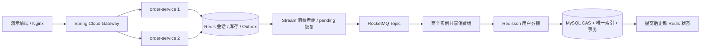

# FlashSale · 高并发优惠券订单系统

[](https://github.com/ZhouHuimin0111/flashsale-order-system/actions/workflows/ci.yml)
  

面向 Java 后端求职的完整实战项目。实现优惠券秒杀、每人每券一单、共享 Token 会话、异步订单确认、点赞排行与共同关注，提供前端、双实例网关、Docker Compose、并发测试与故障恢复测试。

秒杀返回 **HTTP 202 / PENDING 表示预留请求已接收**；只有 MySQL 事务提交后，订单才是 **CONFIRMED**。项目不包含支付、退款、短信或物流。

## 核心实现

| 业务问题 | 实现方式 |
| --- | --- |
| 双实例登录态共享 | Redis Hash 保存随机 Bearer Token 会话；拦截器通过 Lua 原子读取并滑动刷新 30 分钟 TTL；密码 BCrypt 哈希 |
| 重复抢购与 Redis 库存超卖 | Lua 原子检查 Redis 服务端时间、库存及用户资格；重复请求返回同一订单 ID |
| 预扣后进程崩溃，消息未发送 | 同一个 Lua 脚本写入优惠券专属 Redis Stream outbox；消费者组抢占、恢复 pending，再同步发送 RocketMQ |
| 消息重复、响应丢失 | `orderId` 主键与 `(user_id,coupon_id)` 唯一索引；提供用户预留记录恢复查询 |
| MySQL 并发库存正确性 | `stock > 0 AND version = ?` 的乐观 CAS；READ_COMMITTED 重试；扣库存与插订单同一事务 |
| 集群每人每券一单 | Redisson watchdog 分布式锁包围**事务提交**；数据库唯一索引作为锁失效时的最终边界 |
| 热点详情缓存 | Cache Aside、空值短缓存、随机 TTL、分布式互斥重建；修改数据库提交后主动删缓存 |
| 社交功能 | ZSet 原子点赞/取消与文章热度排行、最早点赞用户；Set 关注和交集查共同关注 |
| 集群入口 | Spring Cloud Gateway + LoadBalancer 将 API 请求分发到两个订单实例 |
| 可验证与可恢复 | JUnit/Mockito、Testcontainers 真实 Redis/MySQL 测试、真实 RocketMQ E2E、Broker 故障与应用重启、管理员重投、Prometheus 指标 |

RocketMQ 使用 **Topic、Tag、Consumer Group**。这里没有 RabbitMQ 的 Exchange/Binding。

## 快速运行

需要 Docker Engine + Compose v2，建议至少 4GB 可用内存。第一次构建会下载 Maven 依赖与镜像。

```bash
git clone https://github.com/ZhouHuimin0111/flashsale-order-system.git
cd flashsale-order-system
cp .env.example .env
docker compose up -d --build --wait --wait-timeout 300
```

Windows PowerShell 用 `Copy-Item .env.example .env` 替换 `cp`。打开 **http://localhost:8080**，点击登录/注册创建账号，再参与抢购。

- 前端静态资源由 Nginx 提供；API 通过网关转发，前后端代码和部署分离。
- 初始提供 100 / 50 / 20 份库存，活动从数据库初始化时开始，有效 30 天。
- MySQL、Redis、RocketMQ、应用端口均在容器网络中；只有 Web 8080 绑定宿主 `127.0.0.1`。
- 停止：`docker compose down`，保留数据。查看问题：`docker compose ps -a` 和 `docker compose logs --tail=100`。
- 如果需要管理员，将 `.env` 的 `BOOTSTRAP_ADMIN_PASSWORD` 设置为至少 12 位密码。首次启动创建 `admin`；该配置不会覆盖已有密码。
- 初始化活动过期或测试消耗库存后，使用新目录/新的 Compose project name 创建隔离环境；不要在已有活动上清空 Redis 或重设库存。

## 构建与验证

本地需要 JDK 21；仓库包含 Maven Wrapper，也可使用 Maven 3.9+。集成测试需要可用 Docker。Linux CI 自动执行全部步骤。

```bash
mvn -B -ntp test       # 单元测试，编译包括集成测试代码
mvn -B -ntp verify     # 单元测试 + Testcontainers 真实 Redis/MySQL 并发测试
node --check frontend/app.js
docker compose config -q
```

没有 Maven 时使用 `./mvnw`（Windows 为 `.\mvnw.cmd`）替代 `mvn`。

对**全新的独立 Compose 环境**执行：

```bash
node scripts/e2e.mjs                # 默认 60 用户、120 请求、30 并发，实际 RocketMQ 消费
bash scripts/assert-database.sh    # 独立核验数据库库存、一人一单、订单总量
node scripts/failure-recovery.mjs  # 会暂时停 Broker、重启两个应用，仅用于隔离测试
```

测试脚本会真实消耗优惠券 #3/#2 库存。E2E 拒绝已使用的 #3 活动。`scripts/failure-recovery.mjs` 会操作当前 Compose 服务，禁止用于共享或生产环境。

[GitHub Actions](https://github.com/ZhouHuimin0111/flashsale-order-system/actions) 每次运行保存 `verification-reports`，含 XML、E2E 实测 JSON 和容器日志。请求速率含成功、重复、售罄响应，只是该环境的一次正确性冒烟测试，不能作为生产容量或“万级 QPS”依据。

## 架构



## 目录

```text
gateway/              Spring Cloud 网关与轮询负载均衡
order-service/        登录、缓存、订单、社交、管理恢复接口
  src/main/resources/ Lua 脚本、Flyway SQL
  src/test/           单元与真实依赖并发测试
frontend/             原生 HTML/CSS/JS 前端，无 Node 运行时依赖
infra/                Nginx 与 RocketMQ Broker 配置
scripts/              E2E、SQL 独立断言、故障恢复测试
docs/                 API、架构、运维、简历与面试材料
```

## 一致性与部署边界

- Redis 会话、库存、outbox 和社交数据使用 AOF `appendfsync always`、`noeviction`。系统仍是单 Redis 节点、单 Broker 的开发部署；没有实现跨机房容灾、主从零丢失或生产高可用。
- Lua 原子执行不等于运行错误自动回滚。服务独占业务 Key 类型，需要足够内存；禁止手工修改类型、FLUSHDB、对活动 Key 加 TTL 或裁剪未发送 stream。
- Redis 正常保留时，应用/Broker 故障可恢复。Redis 永久丢失属于人工灾难恢复；已使用优惠券检测到状态缺失会停止自动发布。数据库看不到尚未落单的预留，不能仅凭 DB 重建开放中的库存。
- 详情缓存是最终一致性：提交后删除 + 120–179 秒 TTL；失效失败和并发回填可能短暂读到旧详情。库存预检读取独立的 Lua 库存键，不依赖详情缓存。
- 全部秒杀 Lua Key 使用同一优惠券 hash tag，支持未来 Redis Cluster 的脚本分槽；**当前客户端配置只部署单节点**。社交多键交集使用公共 `{social}`，会成为单槽扩展瓶颈。
- 默认账号密码和单节点配置仅用于本地演示。公网部署应配置 TLS、网络隔离、真实秘密、注册防滥用与高可用；不直接暴露 Actuator 或数据库。

继续阅读：[API](docs/API.md) · [架构与取舍](docs/ARCHITECTURE.md) · [恢复运维](docs/RUNBOOK.md) · [简历与面试](docs/RESUME.md)
