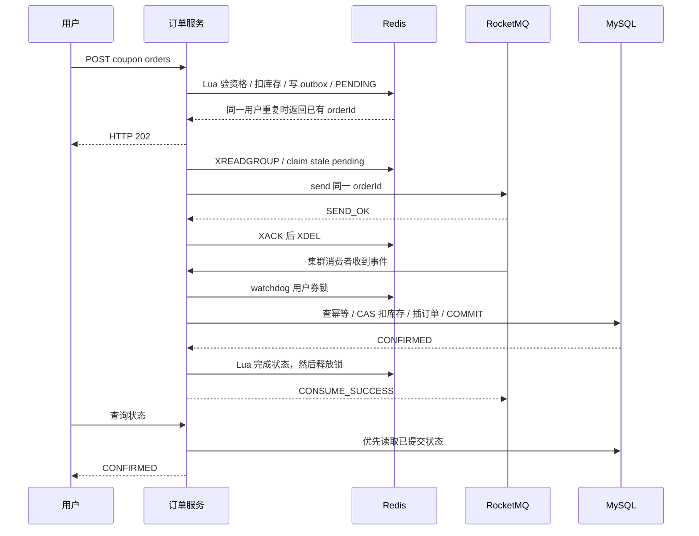

# 订单链路与取舍

## 状态变化

## 两道库存与三道幂等边界

Redis 库存表示**还能接收多少预留请求**，MySQL 库存表示**尚未生成多少已确认订单**。MQ 正在消费时二者暂时不同，正常收敛后应相等；不能把这种差异直接当库存错误。

Lua 在 Redis 内串行执行，用户资格与预扣绑定一个 orderId。Java 方法内生成 UUID，无跨实例本地自增冲突。RocketMQ 至少一次投递，消费者按主键识别重复，不再次扣库存。数据库唯一索引限制每用户每券一个成功订单，即使分布式锁因进程停顿或网络问题失效，也不会生成第二个成功订单。

消费者分布式锁按 `couponId:userId` 粒度。`OrderConsumer` 调用另一个 Spring Bean `OrderWriter`，避免同类自调用导致事务失效。锁在代理方法返回后释放，也就是提交之后。Redisson 不指定 leaseTime，使用 watchdog 自动续约，但它不是数据库 fencing token。

库存 SQL 带版本和 `stock>0`，最多做 8 次 CAS；冲突后读新的版本，READ_COMMITTED 避免重复读事务内一直看到旧快照。超过次数抛异常，由 MQ 重试。每次实际扣库存和插订单在同一 DB 事务，唯一/FK/写入失败会回滚扣减。

## 为什么使用 Redis outbox

只做 Redis 预扣后普通 MQ send，进程可能在两步之间崩溃。反向先发 MQ 再扣库存也不能保证资格。这里在同一个 Lua 中写业务状态和 Redis Stream，使接收与待发送事件位于同一存储原子边界。

Relay 不裁剪未确认消息；先收到 SEND_OK 再 XACK。发送失败或进程崩溃，记录仍在 stream/PEL，30 秒后可以 claim。发送后 ACK 前崩溃会重复发送，数据库幂等处理。ACK 后 XDEL 前崩溃只留下已确认记录，占用空间而不会丢单。

Stream 消费者组从 `0-0` 创建，避免应用重启漏掉历史事件。新优惠券 publish 写一条 seed 来建立 stream；relay 忽略 seed 的业务发送。两实例属于同一个 relay group，竞争消费而不全量复制。

该方案选择 Redis AOF 同步落盘，牺牲一定吞吐换取演示部署的本地持久化；仍不涵盖 Redis 永久介质故障。活动很热时同一 hash slot 是串行瓶颈，要根据真实压测再考虑分桶库存、分片活动与合并写，不提前宣称线性扩展。

## 缓存一致性

Cache Aside：读未命中查数据库并回填；空值 30 秒，普通详情随机 120–179 秒；Redis 分布式锁减少热点回源。管理员修改提交后删缓存，删除失败记日志并依赖 TTL。

并发读可能在删缓存后回填旧快照，因此不保证线性一致性。详情的库存快照没有用于资格判断；返回的 availableStock 直接来自独立库存 hash。更高要求可以引入带版本回填/CDC 失效，本项目保留清晰边界。

## 服务拆分范围

Spring Cloud 用于真实网关和负载均衡。订单、会话、社交仍在一个业务服务内按包组织，没有为了堆技术拆成多个需要分布式事务的小服务。没有声称已实现 Nacos、Feign、Seata 或服务治理集群。
